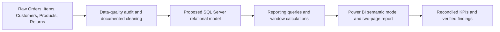

# Analytics pipeline — UrbanCart

The flow below is an **intended architecture only**, pending original dataset/Power BI uploads and runtime review.

**Relationships to verify:** Customers→Orders, Orders→OrderItems, Products→OrderItems, Returns→Orders/Items. Verify source record grain, key uniqueness, orphan records, returns and refund policy. Read [schema contract](../sql/01_schema_contract.sql), [metrics](METRICS.md), and [quality log](DATA_QUALITY.md).
